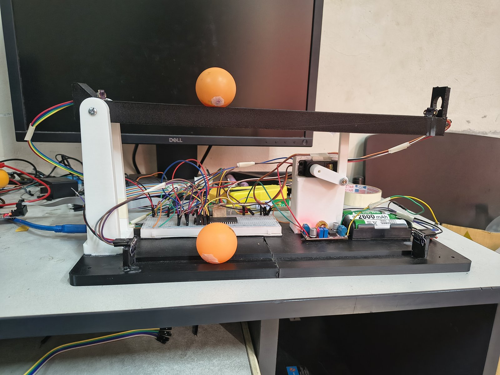
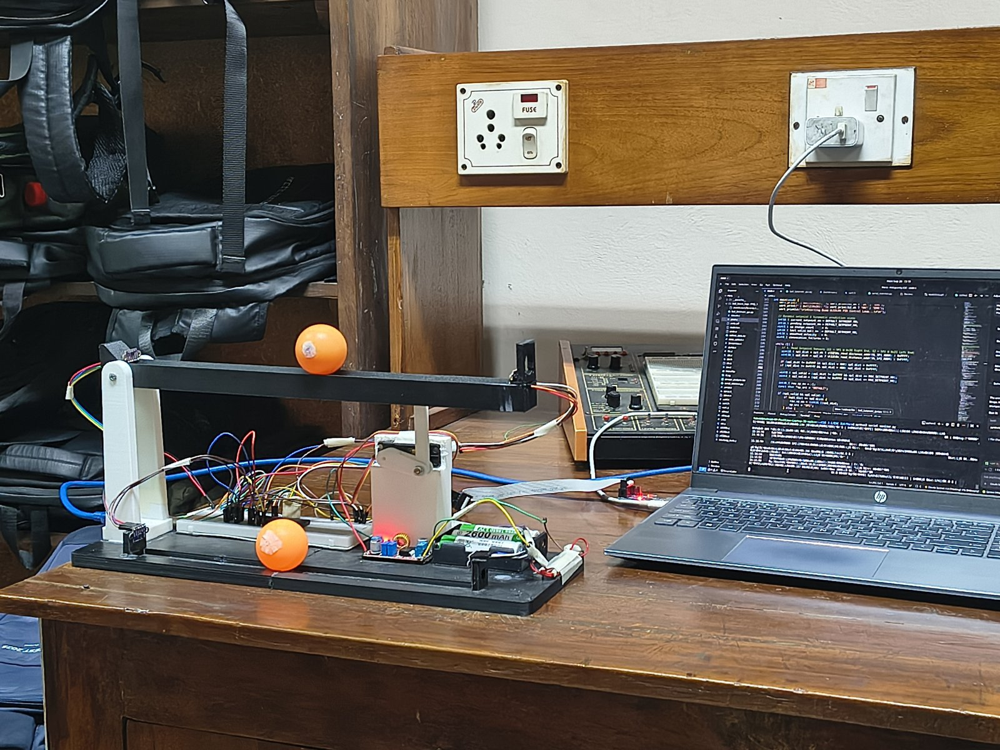

# Dual-Platform Ball Balancing System (ATmega32)

A gravity-driven, underactuated balancing rig built for **CSE 316 — Microprocessors, Microcontrollers and Embedded Systems Sessional** (Dept. of CSE, BUET).

Two balls sit on two platforms. You place a **target ball** anywhere on the fixed lower platform; the ATmega32 tilts the **upper beam** with a servo so that the ball rolling on it moves and settles directly above the target. The upper ball has no motor of its own — it is moved purely by gravity through the beam angle.



> **Note on the design change:** the original proposal (see the [presentation](presentation/index.html)) described two *carts* on guide rails. In the final build the carts were replaced with **balls rolling in V-groove tracks** on two platforms — simpler mechanics, less friction, and the same control problem. The slides are kept as presented; this README describes what was actually built.

## How it works

| Part | Role |
|---|---|
| Lower platform (fixed) | Target ball, placed by hand. Its position is the **setpoint**. |
| Upper beam (tilting) | Ball to be balanced. Pivots on the left pillar, driven by the servo on the right through a 2-bar linkage. |
| 4 × VL53L0X ToF sensors | Two per platform, one at each end, on a shared I²C bus. The closer reading is used, so the ball is tracked along the whole track. |
| ATmega32 @ 8 MHz | Reads sensors, runs the PID loop, drives the servo, streams telemetry over UART. |
| MG995/MG996R servo | Tilts the upper beam (PWM on Timer1). |

Control loop (`firmware/main.c`):

1. Read both setpoint sensors → setpoint position (with a 3-sample "sticky" consensus filter to ignore jitter).
2. Read both ball sensors → ball position. If readings drop out, a short **kinematic predictor** extrapolates from the last velocity (up to 15 steps) before falling back safely.
3. PID on `error = setpoint − ball` (Kp = 15, Ki = 1, Kd = 25, scaled /100), with a ±20 mm deadzone and integral anti-windup.
4. `servo angle = 70° + PID output`, clamped to 0–100° for mechanical safety.
5. Print one telemetry line per loop over UART (9600 baud).

## Repository layout

```
firmware/        AVR C source for ATmega32 (main controller + drivers)
  main.c           Final control firmware (quad VL53L0X + PID)
  data_collect.c   Sensor calibration firmware (ultrasonic vs ToF comparison)
  i2c.*  uart.*  servo.*  vl53l0x.*   Peripheral drivers
  Makefile
tools/           Python helpers that run on the PC
  ball_balancer_gui.py   Live PyQt dashboard (plots + 2D visualisation)
  serial_monitor.py      Timestamped serial monitor
  collect_data.py        Logs calibration data to CSV
hardware/
  cad/           OpenSCAD source of the chassis and upper beam
  stl/frame/     Printable baseplate (3 parts), pivot pillar, servo box, linkage, pins
  stl/upper_beam/ Printable upper beam (full piece or 3 parts)
presentation/    Slides (open index.html in a browser) + physics simulation video
media/           Photos of the build and the mechanism diagram
```

## Wiring (ATmega32)

| Pin | Connected to |
|---|---|
| PC0 / PC1 | I²C SCL / SDA (all four VL53L0X) |
| PC2 | XSHUT — setpoint sensor 1 (right end), addr 0x30 |
| PC3 | XSHUT — setpoint sensor 2 (left end), addr 0x31 |
| PC4 | XSHUT — ball sensor 1 (right end), addr 0x32 |
| PC5 | XSHUT — ball sensor 2 (left end), addr 0x29 |
| PD5 (OC1A) | Servo signal (50 Hz PWM) |
| PD0 / PD1 | UART RX / TX → USB-serial adapter |

The XSHUT pins bring the sensors up one by one at boot so each gets its own I²C address. JTAG is disabled in firmware to free PC2–PC5 — **also clear the JTAGEN fuse** if those pins misbehave.

Power the servo from a separate 5 V supply (shared ground) with a large decoupling capacitor to avoid brown-outs.

## Build & flash

Requires `avr-gcc`, `avr-libc`, `avrdude` and a USBasp programmer.

```bash
cd firmware
make            # builds main.hex and data_collect.hex
make flash      # flash the controller
make flash-slow # use if the programmer can't talk to the chip
make clean
```

## PC tools

```bash
pip install -r tools/requirements.txt
python3 tools/ball_balancer_gui.py          # dashboard (auto-detects /dev/ttyUSB* or /dev/ttyACM*)
python3 tools/serial_monitor.py /dev/ttyUSB0
```

## Hardware

All structural parts are 3D-printed. The `.scad` files in `hardware/cad/` are parametric — set `part_to_render` at the top to export a single part. The upper beam was redesigned as a separate file (`Upper_Beam.scad`) with a 360 mm V-groove track and an end cap for the sensor.



## Team

| Name | Student ID |
|---|---|
| Md. Tahmid Hossain | 2205009 |
| Md. Ashraful Islam Fahim | 2205011 |
| Khandaker Tanvir Hossen | 2205013 |
